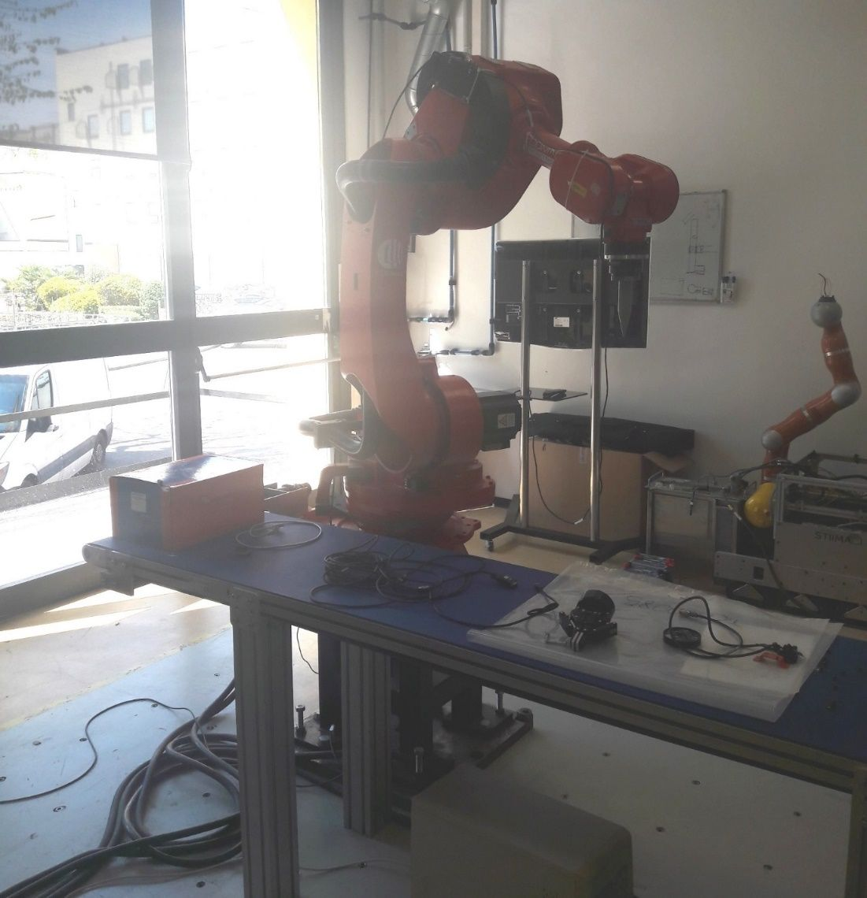

{:.no_toc}

  

    Table of contents
  

  {: .text-delta }
- TOC
{:toc}

# Robotic Motion Planning 
{:.no_toc}

This learning workflow addresses robotic motion planning, with particular emphasis on the visualisation, assessment, communication, and generation of robot trajectories. Students progressively develop and use a digital twin of a robotics laboratory, starting from the configuration of a three-dimensional scene and advancing towards the simulation and evaluation of robot trajectories.

The workflow combines virtual reality, robot-motion data, MQTT communication, and motion-planning tools. It enables students to inspect a robotic system, process joint-position data, create animations, identify possible collisions, evaluate target-reaching accuracy, and generate new trajectories.

## 1. Learning Objectives

Table 1 presents the intended learning outcomes (ILOs) and their associated knowledge types.

| ILO ID | Knowledge type | Description |
|:-------|:---------------|:------------|
| I1 | Factual knowledge | Identify the relevant assets and components of a robotics laboratory. |
| I2 | Conceptual knowledge | Classify the outcome of a robot trajectory according to target-reaching accuracy and the occurrence of collisions. |
| I3 | Procedural knowledge | Process and transform robot-controller messages containing joint-position data. |
| I4 | Procedural knowledge | Visualise and inspect a robot trajectory in a virtual environment. |
| I5 | Procedural knowledge | Receive, process, and publish robot-motion data using a standard communication protocol. |
| I6 | Procedural knowledge | Generate a robot trajectory between specified initial and target configurations. |
| I7 | Procedural knowledge | Evaluate a robot trajectory in terms of feasibility, collision avoidance, and target-reaching accuracy. |
| I8 | Metacognitive knowledge | Assess confidence in the trajectory analysis and the proposed technical solution. |

*Table 1. Intended learning outcomes and associated knowledge types.*

## 2. Use Case

The workflow is applied to the [PERFORM Lab](../UseCases/U02_performlab) (Personal Robotics for Manufacturing Laboratory) at CNR-STIIMA (Figure 1).

The laboratory use case includes an industrial robot, a robot tool, a conveyor, workpieces, and other assets required to reproduce a robotic manufacturing scenario. Its digital representation enables students to analyse robot trajectories without requiring continuous access to the physical laboratory or exposing equipment to unsafe, untested movements.

Figure 1: PERFORM Lab

## 3. Learning Activities

The learning activities are organised into three levels of increasing complexity:

- Level 1 – Visualising and assessing predefined robot trajectories

    Students explore the digital representation of the robotics laboratory, identify relevant assets, process four predefined trajectories, visualise them in the virtual environment, and evaluate their execution.

- Level 2 – Receiving and processing trajectories from a robot-controller emulator

    Students use MQTT to receive joint-position messages generated by a robot-controller emulator. They process the messages, convert the trajectory into an animation, visualise it in the virtual environment, and evaluate the result.

- Level 3 – Generating and assessing a new robot trajectory

    Students use a motion-planning method or tool to generate a new trajectory between specified initial and target configurations. They then convert, visualise, and evaluate the trajectory using the same process applied in the previous levels.

Table 2 links each task to the relevant intended learning outcomes.

| Task ID | Task | Description | Related ILOs |
|:--------|:-----|:------------|:-------------|
| T1.1 | Explore the robotics laboratory | Visualise the laboratory scene using a VR application, identify relevant assets such as the robot, tool, conveyor, and workpiece, and inspect their local coordinate systems. | I1 |
| T1.2 | Process predefined trajectories | Read the joint positions of four predefined trajectories and convert them into animation files compatible with the selected virtual environment. | I3 |
| T1.3 | Visualise predefined trajectories | Play and inspect the four robot trajectories in the virtual environment. | I4 |
| T1.4 | Assess predefined trajectories | Determine whether each trajectory reaches its target, identify possible collisions, and calculate the final distance between the robot tool and the target. | I2, I7, I8 |
| T2.1 | Retrieve a trajectory through MQTT | Receive and store messages containing robot joint positions generated by a robot-controller emulator. | I5 |
| T2.2 | Process the received trajectory | Parse the received joint-position data and convert the trajectory into an animation file compatible with the virtual environment. | I3, I5 |
| T2.3 | Visualise the received trajectory | Play and inspect the received robot trajectory in the virtual environment. | I4 |
| T2.4 | Assess the received trajectory | Determine whether the trajectory reaches its target, identify possible collisions, and calculate the final distance between the robot tool and the target. | I2, I7, I8 |
| T2.5 | Develop an MQTT client | Develop an MQTT client that receives messages from the robot-controller emulator, processes the joint-position data, generates an animation, and publishes the animation through MQTT. | I3, I5 |
| T3.1 | Generate a new trajectory | Use a suitable motion-planning method or tool to generate a robot trajectory between specified initial and target configurations. | I6 |
| T3.2 | Process the generated trajectory | Convert the generated joint positions into an animation file compatible with the virtual environment. | I3 |
| T3.3 | Visualise the generated trajectory | Play and inspect the generated robot trajectory in the virtual environment. | I4 |
| T3.4 | Assess the generated trajectory | Evaluate target-reaching accuracy, identify possible collisions, document limitations, and assess confidence in the result. | I2, I7, I8 |

*Table 2. Learning tasks and related intended learning outcomes.*

## 4. Technology

The workflow combines a digital twin of the robotics laboratory, a virtual environment, robot-motion data, motion-planning software, and MQTT-based communication.

### 4.1 Assets and scene configuration

A digital twin of the laboratory was developed to support research and teaching activities. The [online resources](../UseCases/U02_performlab#online-resources) include:

- three-dimensional asset models in **glTF** format;
- scene configurations represented in JSON;
- robot-trajectory data;
- descriptions of the assets and their spatial relationships.

The JSON scene configuration follows a dedicated [schema](https://virtualfactory.gitbook.io/vlft/kb/instantiation/assets/json).

### 4.2 Virtual environment

The three-dimensional scene can be visualised using different engines and development environments, including Unity, Unreal Engine, Godot, and Babylon.js.

This workflow uses [VEB.js](../Tools#vebjs), a web-based prototype application that supports reconfigurable, model-driven virtual environments. The [PERFORM Lab VEB.js demonstration](https://xrlearning.github.io/repo/UseCases/PerformLab/PERFORM.html) can be accessed through a compatible web browser.

### 4.3 Robot motion planning and simulation

Planning, managing, and monitoring robot trajectories can be supported by tools such as:

- [MoveIt](https://moveit.ai/);
- Gazebo;
- RoboDK;
- Siemens Process Simulate;
- other Robot Operating System (ROS) tools.

In Levels 1 and 2, trajectory generation is outside the scope of the learning activities because predefined or externally generated trajectories are used as input. In Level 3, students generate a new trajectory using a suitable motion-planning method or tool.

The reference trajectories for the PERFORM Lab were generated using MoveIt.

### 4.4 Joint-position data

During the execution of the trajectory, the robot controller can communicate the joint state (i.e. position, velocity, force/torque, etc.) that in turn can be stored (e.g. in a text-based file) or published (e.g. via MQTT). We take in consideration only the joint position, i.e. the rotation angle of the joint. The joint angles are likely to be measured by sensors or encoders that are attached to the robot joints. These sensors can generate data at a high rate, potentially several times per second or even faster, depending on the specific application and the performance requirements.

The joint positions of the robot in the PERFORM Lab are saved at 10 Hz (i.e. one position is stored every 0.1 \[s\]) in a JSON file that contains a list of position items, where each item defines the angles of the joints in radians \[rad\]. Here below an example of item is shown:

**{**

**"J1": 0.0,**

**"J2": 0.0,**

**"J3": 1.57,**

**"J4": 0.0,**

**"J5": -1.57,**

**"J6": 0.0,**

**"J7": 0.0,**

**"J8": 0.0,**

**"J9": 0.0,**

**"J10": 0.0**

**}**

Each item of the list reports by default the value of 10 joint angles. Robot_1 of PERFORM Lab consists of 6 joints, therefore only joints from "J1" to "J6" contain relevant values while the others (from "J7" to "J10") will be always set to zero.

An example can be seen in the [file](https://github.com/difactory/DF/blob/main/docs/AVATAR-JLL/files/trajectory_example.json) that defines a trajectory moving the tool along the vertical axis.

### 4.4 MQTT Communication

[MQTT](https://mqtt.org/) (Message Queuing Telemetry Transport) is a lightweight, publish-subscribe messaging protocol that is commonly used in the Internet of Things (IoT) and other applications.

MQTT can be exploited for bi-directional communications with robots:

- sending feedback about joint states

- receiving commands for the execution of trajectories

Different programming languages can be used to develop MQTT clients, e.g. JavaScript and Pyhton libraries. In addition to publishers and subscribers, the MQTT architecture needs a broker to manage messages.

Several resources are freely available online to develop MQTT architectures, such as free public MQTT broker (e.g. [broker.emqx.io](https://www.emqx.com/en/mqtt/public-mqtt5-broker)) and libraries to develop MQTT components (e.g. [MQTT.js](https://www.npmjs.com/package/mqtt)).

The robot controller can publish a message containing the current joint states. Because of security resons, the messages can be generated by an emulator of the robot controller that is launched using the web application OntoGuiWeb. Specifically, the module [MQTT Sync](https://virtualfactory.gitbook.io/vlft/tools/ontoguiweb/modules/mqtt-sync) provides functionalities as an MQTT client to publish messages and subscribe to topics.

VEB.js can play the role of both [publisher and subscriber](https://virtualfactory.gitbook.io/vlft/tools/vebjs/functionalities#4.-animation-panel), exchanging messages that are structured to the animation json schema.

## 5. User Experience

The virtual environment enables students to explore the robotics laboratory and inspect the execution of robot trajectories from viewpoints that may be difficult or unsafe to access in the physical laboratory. Students can: 
- navigate through the virtual laboratory; 
- identify robots, tools, conveyors, workpieces, and other assets; 
- inspect asset positions and local coordinate systems; 
- play, pause, and replay robot animations; 
- observe the trajectory from multiple viewpoints; 
- compare several trajectories; 
- inspect the final position of the robot tool relative to the target; 
- identify visible collisions or unsafe movements.

The assessment of the learning task is carried out by analyzing the output of the various tasks, as defined in Table 3.
The following trajectories are provided as list of joint positions defined in a JSON file:
- [trajectory_1.json](https://xrlearning.github.io/repo/UseCases/PerformLab/trajectory_1.json)
- [trajectory_2.json](https://xrlearning.github.io/repo/UseCases/PerformLab/trajectory_2.json)
- [trajectory_3.json](https://xrlearning.github.io/repo/UseCases/PerformLab/trajectory_3.json)
- [trajectory_4.json](https://xrlearning.github.io/repo/UseCases/PerformLab/trajectory_4.json)

Before starting the activities, the instructor should verify that:
- the files are accessible from the student network;
- the JSON structure is compatible with the selected virtual environment;
- the coordinate systems and measurement units are documented;
- the MQTT broker and topics are configured, where applicable;
- the robot model uses the expected joint order.

Assessment is based on the outputs produced during each task. The evaluation combines inspection of submitted files, automated validation where possible, observation of animations, collision analysis, target-distance measurements, and review of the implemented software.

| Task ID | Expected output | Assessment method |
|:--------|:----------------|:------------------|
| T1.1 | Screenshots of the virtual scene identifying the robot, tool, conveyor, workpiece, and relevant coordinate systems | Check the correct identification of assets and coordinate systems. |
| T1.2 | Four animation files and the script or program used to process the trajectory data | Validate the file structure, joint ordering, number of trajectory records, and compatibility with the virtual environment. |
| T1.3 | Video or screen recording of the four trajectories | Verify that all trajectories can be played correctly and correspond to the provided data. |
| T1.4 | Assessment report for each trajectory | Check target attainment, collision identification, final tool-to-target distance, and confidence rating. |
| T2.1 | Robot trajectory received and stored in a structured text format | Compare the received data with the messages published by the robot-controller emulator. |
| T2.2 | Animation file generated from the received MQTT messages | Validate data parsing, temporal order, joint mapping, and animation compatibility. |
| T2.3 | Video or screen recording of the received trajectory | Verify that the animation represents the received MQTT data. |
| T2.4 | Assessment report for the received trajectory | Check target attainment, collision identification, final distance, and confidence rating. |
| T2.5 | Source code and documentation for the MQTT client | Test connection, subscription, message processing, error handling, and publication of the generated animation. |
| T3.1 | Description of the motion-planning procedure and generated trajectory file | Assess the method, initial and target configurations, trajectory completeness, and reproducibility. |
| T3.2 | Animation file generated from the new trajectory | Validate data structure, joint mapping, and compatibility with the virtual environment. |
| T3.3 | Video or screen recording of the generated trajectory | Verify that the animation corresponds to the generated trajectory. |
| T3.4 | Final trajectory-assessment report | Assess target accuracy, collision avoidance, technical limitations, and confidence in the result. |

*Table 3. Expected outputs and assessment methods.*

Each trajectory should be assessed using the following criteria:

1. **Target attainment:** whether the trajectory reaches the specified target.
2. **Final-position error:** Euclidean distance between the final position of the robot tool and the target position.
3. **Collision occurrence:** whether the robot or tool collides with another asset.
4. **Trajectory completeness:** whether all trajectory records can be processed and visualised.
5. **Joint-limit compliance:** whether joint positions remain within the permitted limits, if these limits are available.
6. **Execution continuity:** whether the animation contains discontinuities or unexpected jumps.

