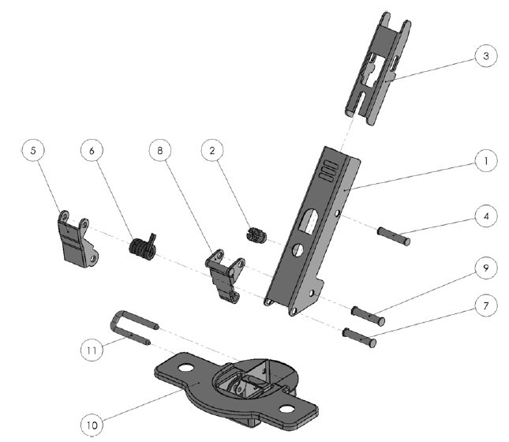
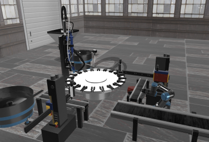
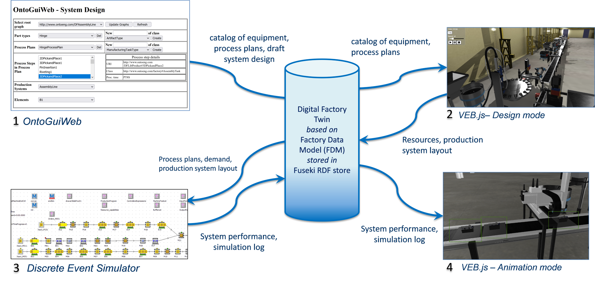

{:.no_toc}

  

    Table of contents
  

  {: .text-delta }
- TOC
{:toc}

# Design and Analysis of Manufacturing Systems
{:.no_toc}

The design and analysis of manufacturing systems is a complex engineering activity requiring multidisciplinary knowledge to satisfy production requirements. A manufacturing system comprises production, handling, transportation, storage, and control resources, each characterised by specific functions and capabilities. The way these resources are configured and integrated determines the overall capabilities and performance of the system.

Manufacturing-system design is guided by production requirements and key performance indicators (KPIs), such as throughput, lead time, resource utilisation, work in progress, and service level. Evaluating alternative system configurations therefore requires suitable modelling and analysis methods, including discrete-event simulation.

This learning workflow uses an immersive virtual representation of an industrial assembly line to help students understand its structure and behaviour, formulate a conceptual model, estimate model parameters, and evaluate system performance.

## 1. Learning Objectives

Following the revised taxonomy proposed by Anderson et al. (see Section 3.1), the knowledge addressed by this workflow is organised into four categories: factual, conceptual, procedural, and metacognitive knowledge.

**1. Factual Knowledge**

- **1.1** *Knowledge of terminology*: Ability to recognize and differentiate between various types of equipment. 

- **1.2** *Knowledge of specific details and elements*: Ability to identify the properties of objects.

**2. Conceptual Knowledge**

- **2.1** *Knowledge of classifications and categories*: Ability to classify equipment based on its function, such as production resources, transportation resources, or buffers.

- **2.2** *Knowledge of principles and generalizations*: Ability to comprehend the movement of parts within manufacturing cells in the virtual environment.

- **2.3** *Knowledge of theories, models, and structures*: Ability to recognize different types of manufacturing system architectures, such as flow shop, job shop, and others.

**3. Procedural Knowledge**

- **3.1** *Knowledge of subject-specific skills and algorithms*: Ability to apply performance evaluation techniques (e.g., discrete event simulation) to model and assess the performance of a manufacturing system.

- **3.2** *Knowledge of subject-specific techniques and methods*: 1) Ability to analyze manufacturing system behavior and evaluate functional parameters. 2) Ability to develop a performance evaluation model based on the conceptual model of the manufacturing system.

- **3.3** *Knowledge of criteria for determining when to use appropriate procedures*: Ability to formulate accurate hypotheses and generate a conceptual model of the manufacturing system being studied.

**4. Metacognitive Knowledge**

- **4.1** *Self-knowledge*: Ability to evaluate one's own confidence in responses to questions or solutions to exercises.

Table 1 reports the specific ILOs with the associated type of knowledge.

| **ILO** | **Knowledge type** | **ILO description**                                                                                                                                                  |
|---------|--------------------|----------------------------------------------------------------------------------------------------------------------------------------------------------------------|
| I1      | 1.1                | Identify different types of equipment.                                                                                                                               |
| I2      | 1.1                | Identify the product undergoing the manufacturing process and its components.                                                                                        |
| I3      | 1.2                | Identify the attributes of an object in the virtual environment.                                                                                                     |
| I4      | 2.1                | Classify the pieces of equipment according to their class.                                                                                                           |
| I5      | 2.2                | Identify the flow of parts within the manufacturing system in the virtual environment.                                                                               |
| I6      | 2.3                | Identify the type of manufacturing system architecture.                                                                                                              |
| I7      | 3.2              | Analyse the behaviour of manufacturing systems and assess functional parameters.                                                                                     |
| I8      | 3.3                | Make proper hypotheses and generate a conceptual model of the manufacturing system under study.                                                                      |
| I9      | 3.2              | Develop a performance evaluation model based on a conceptual model of the manufacturing system.                                                                      |
| I10     | 3.1                | Evaluate the performance of a manufacturing system.                                                                                                                  |
| I11     | 4.1                | Self-assess the replies. Students will be asked to provide an estimation of the confidence they have with respect to their replies and numerical solutions provided. |

Table 1: ILOs with associated knowledge type 

## 2. Use Case

The workflow is applied to an industrial [assembly line](../UseCases/U04_assemblyline) that produces self-closing concealed cabinet hinges. The system comprises 19 workstations that perform operations such as component feeding, pick-and-place handling, screw tightening, riveting, inspection, and transportation.

The use case enables students to:

- identify products, components, and manufacturing resources;
- understand the routing and transformation of parts;
- examine the relationships among processes and resources;
- recognise the manufacturing-system architecture;
- estimate processing and reliability parameters;
- develop a conceptual and simulation model;
- evaluate the performance of the assembly line.

The components of the self-closing concealed cabinet hinge are shown in Figure 1.

Figure 1: Hinge components

## 3. Learning Activities

The learning activities are organised into three levels of increasing complexity:

- Level 1 – Understanding what a manufacturing system consists of

  Students explore the virtual factory to identify manufacturing equipment, products, components, and object properties. The activities establish the factual knowledge required for the subsequent analysis tasks.
- Level 2 – Understanding how a manufacturing system operates

  Students classify resources according to their functions, analyse the routing and transformation of parts, identify assembly points and workstations, and determine the architecture of the manufacturing system.

- Level 3 – Evaluating manufacturing-system performance

  Students estimate processing and reliability parameters, formulate modelling assumptions, select suitable analysis methods, develop a performance-evaluation model, and use the model to assess the manufacturing system against production requirements.

A self-assessment task accompanies the three levels and asks students to report their confidence in the answers and numerical results produced. Table 2 links each task to the relevant intended learning outcomes.

| Task ID | Task | Description | Related ILOs |
|:--------|:-----|:------------|:-------------|
| T1.1 | Count equipment instances | Count the instances of a specified equipment type, such as conveyors, robots, or rotary tables, and report their name, classification, and function. | I1, I4 |
| T1.2 | Locate equipment | Determine whether at least one instance of a specified equipment type is present in the virtual environment and identify its location. | I1 |
| T1.3 | Identify factory objects | Assign the provided labels to the corresponding equipment, products, or components in the virtual environment. | I1, I2 |
| T1.4 | Report object properties | Retrieve and report the properties of an object or derive a requested measure, such as the distance between two workstations. | I3 |
| T2.1 | Identify processed parts | Identify the part undergoing processing and, for an assembly, identify its components. | I2 |
| T2.2 | Classify factory objects | Classify factory objects according to their functions, such as processing, handling, transportation, storage, inspection, or control. | I4 |
| T2.3 | Trace part routing | Determine the sequence of workstations through which a selected part travels. | I5 |
| T2.4 | Locate assembly points | Identify the workstation at which a part and a component are combined. | I2, I5 |
| T2.5 | Identify system architecture | Identify and justify the manufacturing-system architecture, such as a flow shop or job shop. | I6 |
| T2.6 | List workstations | Identify and order the workstations involved in the manufacturing process. | I5, I6 |
| T3.1 | Estimate processing times | Estimate workstation processing times by observing animations or analysing operational data and event logs. | I7 |
| T3.2 | Estimate reliability parameters | Analyse event or failure data to estimate parameters such as mean time to failure (MTTF) and mean time to repair (MTTR). | I7 |
| T3.3 | Validate modelling assumptions | Evaluate whether a proposed modelling assumption is supported by the available system information and data. | I8 |
| T3.4 | Select an analysis method | Select and justify an appropriate modelling or analysis method for the system and performance question under study. | I8 |
| T3.5 | Estimate model parameters | Estimate the parameters required by the selected model, such as the number of servers, buffer capacity, processing-time distributions, failure parameters, or routing probabilities. | I7, I9 |
| T3.6 | Evaluate system performance | Use the selected method to calculate KPIs and draw conclusions, such as the maximum daily output or buffer capacity required to satisfy demand. | I10 |
| TS | Assess confidence | Report confidence in the answers, assumptions, and numerical results produced during the learning activities. | I11 |

*Table 2. Learning tasks and related intended learning outcomes.*

## 4. Technology

The workflow combines a digital representation of the assembly line, a web-based virtual environment, an online learning-management system, semantic modelling tools, and discrete-event simulation.

### 4.1 Digital assets and scene configuration
{:.no_toc}

A digital twin of the assembly line was developed to support teaching and research activities. The [online resources](../UseCases/U04_assemblyline#online-resources) include:

- three-dimensional asset models in **glTF** format;
- a scene configuration represented in JSON;
- structured descriptions of factory objects and their properties;
- operational data required by the analysis tasks.

The JSON scene configuration follows a dedicated [schema](https://virtualfactory.gitbook.io/vlft/kb/instantiation/assets/json).

### 4.2 Virtual environment
{:.no_toc}

Virtual reality enables students to explore the assembly line through an immersive factory walkthrough. The workflow uses the [VEB.js prototype application](../Tools#vebjs) to render the industrial environment and provide access to information associated with products, resources, and workstations. Figure 2 illustrates how the industrial environment, including the assembly line, is rendered within VEB.js.

Figure 2: Screenshot of VEB.js application showing the assembly line use case

### 4.3 Learning activities and assessment
{:.no_toc}

The learning tasks and corresponding assessments can be delivered through [Moodle](https://moodle.org/). Moodle supports several question types relevant to this workflow, including:

- multiple-choice questions;
- numerical questions;
- drag-and-drop labelling of images;
- selection of missing words;
- file submissions;
- confidence-rating questions.

### 4.4 Digital model
{:.no_toc}

Factory objects, object properties, spatial placement, three-dimensional representations, and relationships can be defined using [OntoGuiWeb](../Tools#ontoguiweb). The tool provides a graphical interface for creating and exploring factory models represented through an ontology-based data model.

### 4.5 Discrete-event simulation
{:.no_toc}

A discrete-event simulation tool can be used to generate operational events, derive performance indicators, and animate the virtual scene. One suitable implementation is [Java Modelling Tools](https://jmt.sourceforge.net/), although alternative simulation tools may be adopted if they provide the required modelling and data-exchange capabilities.

Figure 3 shows the integration of the digital tools employed to model the industrial case. 

Figure 3: Integrated digital tools and data repository

## 5. User Experience

The virtual environment allows students to explore the industrial setting and retrieve the information required to complete the learning tasks. The graphical user interface supports direct interaction with factory objects and access to object-related resources.

Students can select objects in the virtual environment to retrieve information such as:

- object name and identifier;
- dimensions and spatial position;
- functional description;
- object class and function;
- relationships with other factory objects;
- relevant operational parameters.

These data help students understand the structure and connectivity of the manufacturing system.

Objects in the virtual environment may provide links to supporting resources, including:

- lecture slides and explanatory material;
- technical data sheets;
- three-dimensional models;
- event and failure logs;
- processing-time data;
- maintenance and production reports.

Direct access to these resources enables students to combine visual exploration with data-driven analysis.

The workflow can support:

- **desktop interaction** using a mouse and keyboard;
- **immersive interaction** using a VR headset and motion controllers;
- **individual activities** completed independently;
- **collaborative activities** supported by a conferencing or multiplayer platform.

This combination allows the workflow to be used in classroom, laboratory, blended, and remote-learning settings.

Assessment is performed through the outputs generated by the learning tasks. Moodle can be used to administer automatically scored questions, collect files, provide feedback, and record student confidence ratings. Tasks involving conceptual models, simulation models, and written conclusions require instructor review or a predefined assessment rubric.

| Task group | Evidence collected | Assessment method |
|:-----------|:-------------------|:------------------|
| T1.1–T1.4 | Equipment counts, selected labels, object classifications, reported properties, and calculated measures | Automatic comparison with reference answers, with numerical tolerances where appropriate |
| T2.1–T2.6 | Identification of products and components, resource classifications, part routes, assembly points, workstation sequences, and system architecture | Automatic scoring combined with review of short written justifications |
| T3.1–T3.2 | Estimated processing times, MTTF, MTTR, and other operational parameters | Comparison with reference values or acceptable intervals |
| T3.3–T3.4 | Modelling assumptions and selected analysis methods | Assessment of suitability, justification, and consistency |
| T3.5 | Parameterised performance-evaluation model | Review of completeness, correctness, traceability to source data, and internal consistency |
| T3.6 | Calculated KPIs and interpretation of the results | Comparison with benchmark results |
| TS | Confidence rating associated with each answer or result | Comparison between confidence and answer correctness to support metacognitive reflection |

*Table 3. Evidence and assessment methods for the learning tasks.*

