{:.no_toc}

 
  

    Table of contents
  

  {: .text-delta }
- TOC
{:toc}

# XR Learning Workshops
{:.no_toc}

## Workshop in Tallinn (10-12 June 2024)

The first XR Learning Workshop of the XREN project was held at Tallinn University of Technology (TalTech) in Tallinn, Estonia, from 10 to 12 June 2024. The event marked an important milestone in our journey towards advancing technology-enhanced engineering education within the framework of the Erasmus+ project *Extended Reality Tools to Support Learning Activities in Engineering (XREN)*. The workshop brought together students and tutors from XREN consortium partners, including TalTech, Politecnico di Milano (Polimi), the University of Belgrade, and CNR-STIIMA. The workshop provided a collaborative and engaging environment in which participants could exchange knowledge, explore XR-supported learning approaches, and work together on innovative learning activities.

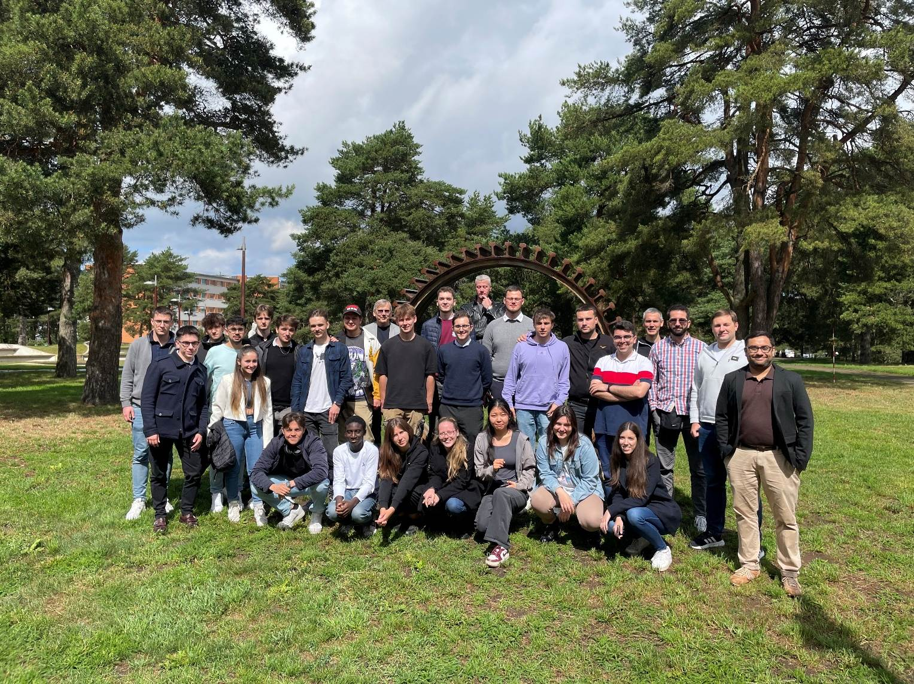

### Activities
{:.no_toc}

The workshop activities were organised into the following modules.

1. **Introduction and team building** 

    The workshop began with an introduction to the XR Learning Workshop and an overview of the Joint Lab task, *“Development of an AR Platform for Robot Interaction and Path Planning.”* Participants were introduced to the objectives, expected outcomes, and working approach, followed by team-building activities.

    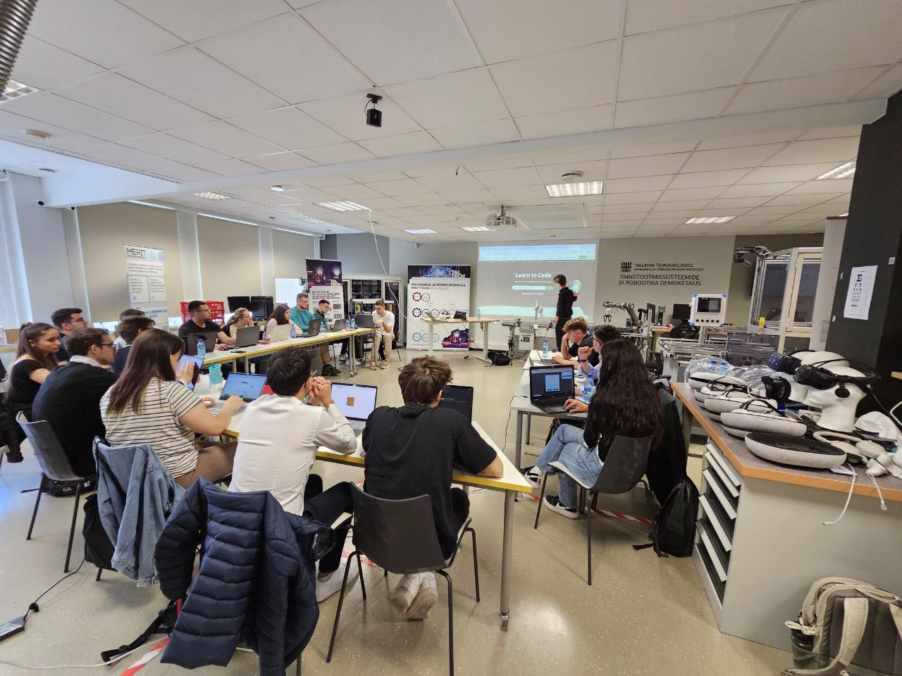

2. **XR tools and software setup** 

    Students gained practical experience with XR-related tools and the required software environment. The activities covered user interface interaction in VR, design guidelines, and the possibilities offered by immersive technologies. The technological stack for the WebXR environment included Next.js, API calls, Hooks, and Three.js. 
    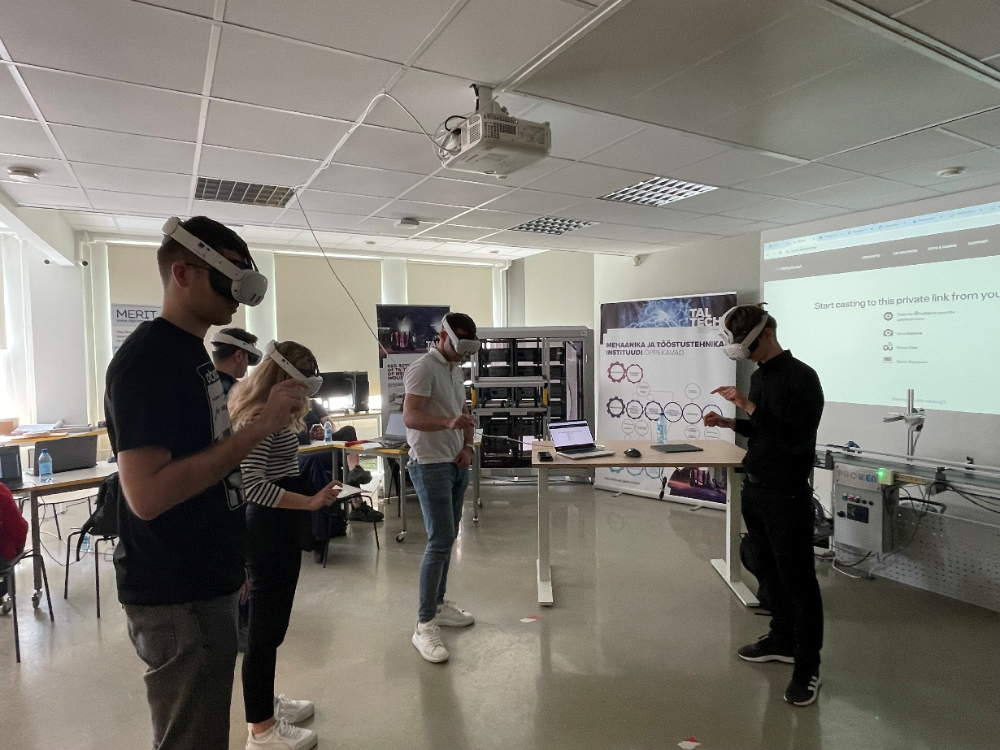

3. **Robot connectivity and AR platform development** 

    Students tested robot connectivity and communication using the selected XR tools and software. Throughout the Joint Lab activities conducted in the TalTech IVAR Lab, students worked in teams to develop an AR platform using the Meta Quest 3 headset. The developed platform enables users to monitor the current state of the Yaskawa Motoman GP8 robot, directly control its operation, and create robot path plans, thereby supporting spatial understanding and enhancing the overall user experience.
    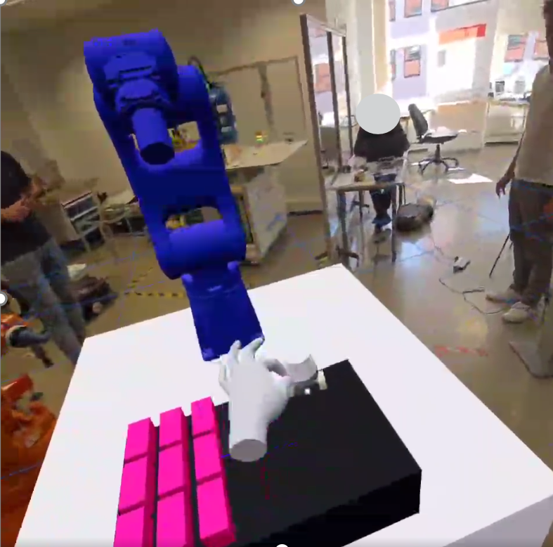

4. **Teamwork and practical demonstration** 

    Each team successfully developed and executed a robot recipe for constructing structures from wooden blocks, simulating a pick-and-place process. At the end of the activity, the teams presented their solutions, individual and collective contributions, and key learning experiences.

    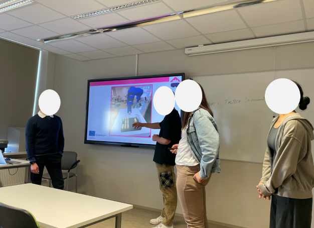

5. **Parallel learning activity – pneumatic system assembly**

    As a parallel activity, students tested and experienced an AR-supported learning environment for the assembly and operation of pneumatic systems. They completed a pneumatic circuit assembly task as a hands-on learning exercise and experienced two different learning modes: first, assembling the circuit in the physical laboratory using a traditional paper-based guide; and second, performing the learning activity with support from an immersive AR-based environment. This provided students with practical experience of both conventional and XR-supported approaches to engineering learning.

### Assessment
{:.no_toc}

A total of 20 students responded to questions regarding their expectations for the workshop in Tallinn. The responses were collected through a questionnaire consisting of open-ended questions. As part of the expectations survey, students were asked to provide “five adjectives that you associate with the workshop experience.” The adjectives reported by the students, reflecting their anticipated perceptions and expectations of the workshop, are illustrated in the figure below.

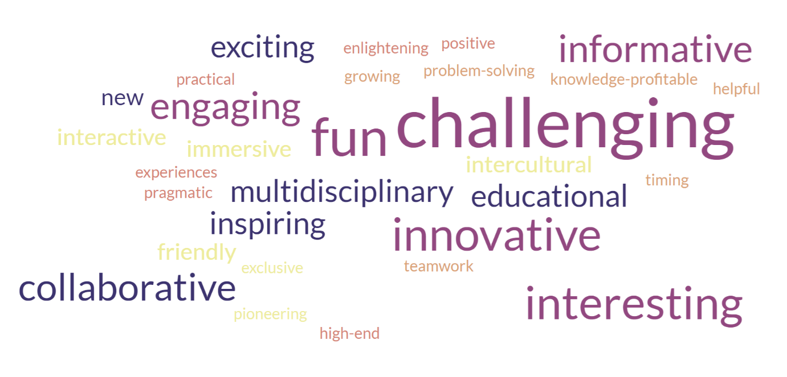

Students’ engagement during the workshop was also assessed through a questionnaire comprising seven items, each rated on a five-point Likert scale (1–5). The results provide insights into the students’ level of engagement throughout the workshop and are presented in the graph below.

The results indicate that participants feel highly committed, successful, and motivated, but their alertness, confidence, performance, and control are moderate to low. This suggests that while they are driven and feel successful, there might be areas to improve regarding their confidence and perceived control over tasks [1].

## Workshop in Milan (19-21 May 2025)

The second XR Learning Workshop of the XREN project was held at the
Politecnico di Milano in Milan, Italy, from 19 to 21 May 2025. The event,
titled *Extended Reality Tools to Support Learning Activities in
Engineering*, brought together students and project partners to explore how
extended reality (XR) can support engineering education.

The workshop contributed to the objectives of the XREN Erasmus+ project by
connecting the project’s XR learning workflows and applications with a
hands-on educational setting. It gave participants the opportunity to compare
physical and virtual learning experiences, apply good practices for designing
XR-based learning activities, and collaboratively improve an existing learning
application. In this way, the event linked technical development with the
project’s broader aim of making engineering learning more interactive,
practice-oriented, and accessible through XR.

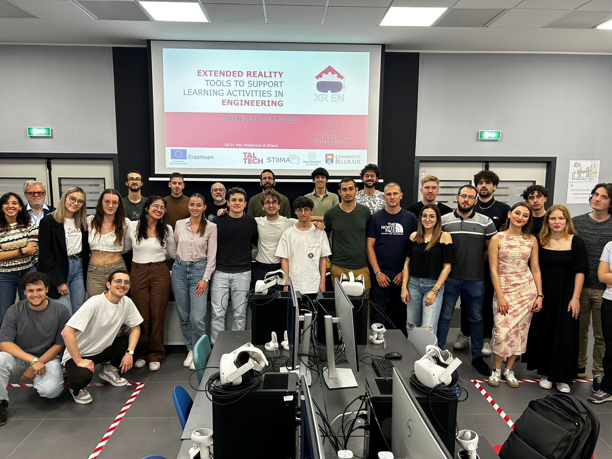

### Activities
{:.no_toc}

The workshop activities were organised around three complementary strands:

1. **Technical workshops**

   - Introduction to the software and tools used for XR development.
   - Practical introduction to Unity for virtual-reality development.
   - Design of user interfaces and interaction in VR.
   - Discussion of XR design methodologies and good practices.
   - Definition of learning objectives and structuring of XR-based learning
     workflows.
   - Team work to apply the learning-workflow concepts and improve the XR
     learning experience.

2. **Laboratory activity: VR versus hands-on product analysis**

   Students worked with a worm gearbox in two parallel modes: disassembly of
   a physical prototype and disassembly of the same product in a VR
   application. 
   
   
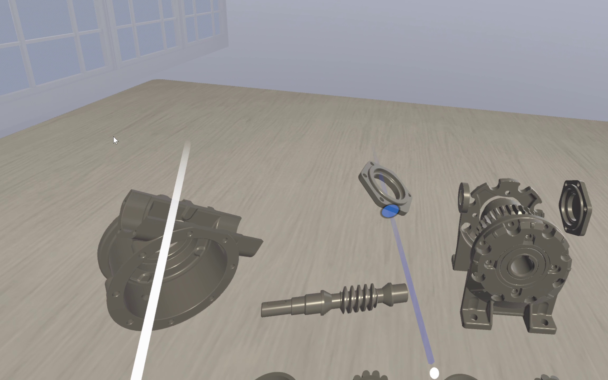

   The activity included a pre-assessment, two rounds in which
   groups exchanged experiences, learning and post-activity questionnaires,
   and a final focus-group discussion. Its objective was to examine the
   effectiveness of XR in supporting the learning of an engineering topic in
   comparison with direct practical experience.

   
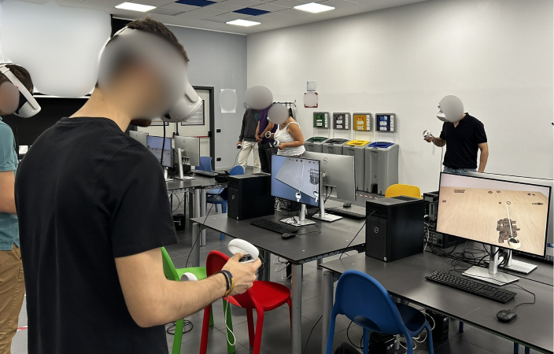

3. **Final student challenge**

   After testing the application, the students formed teams and identified
   opportunities to improve its XR interaction and learning experience. They
   then developed and deployed their proposed improvements, prepared a final
   presentation, and discussed their work during a shared wrap-up session with
   questions and answers.

### Assessment
{:.no_toc}

The laboratory assessment measured the number of questions answered correctly
about the gearbox and its operation. In the reported results, the physical
experience group achieved 69 correct answers in total, while the VR experience
group achieved 60. The physical experience therefore produced the higher raw
total in this activity. The comparison should be interpreted descriptively,
since the reported groups were not the same size (13 students in the physical
condition and 10 in the VR condition).

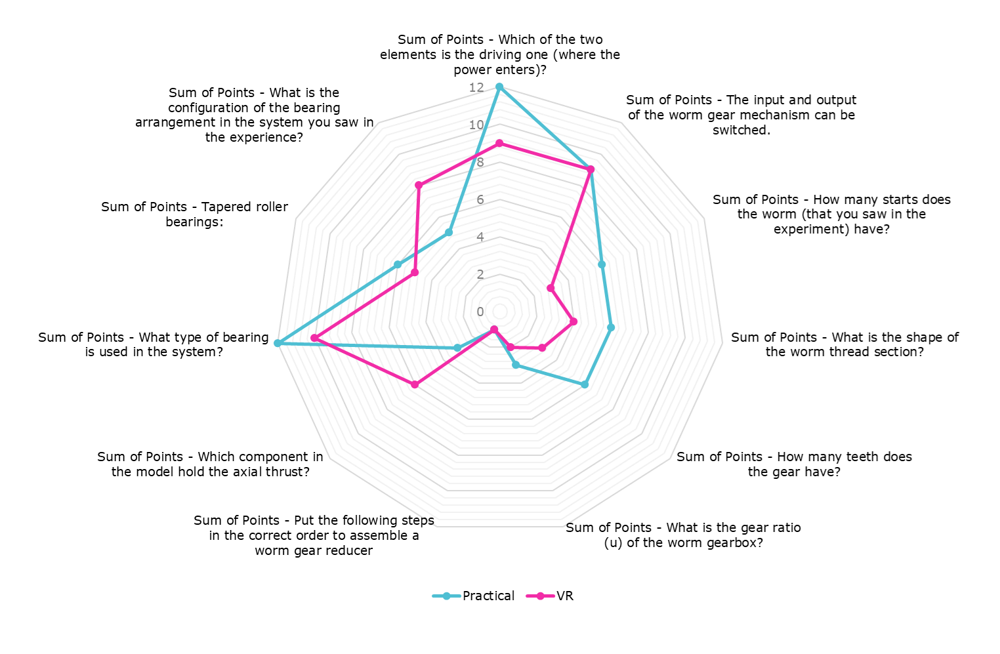

The item-level results also showed a mixed pattern rather than a uniform
advantage for one mode. The physical condition performed better on several
questions concerning the driving element, the number of gear teeth, the worm
thread, the number of worm starts, and the gear ratio. The VR condition scored
higher on identifying the bearing arrangement and the component carrying the
axial thrust, while both conditions obtained the same result for whether the
worm mechanism’s input and output could be switched and for ordering the
assembly steps [2].

## Workshop in Lecco (02-05 July 2025)

The third XR Learning Workshop of the XREN project was held in Lecco, Italy, from 2 to 5 July 2025, as part of the EuroXR Summer School. The event brought together 31 students, including 14 students participating through XREN, in an international and multidisciplinary environment for exploring the application of extended reality in education and professional practice.

The workshop combined lectures, demonstrations, collaborative project work, and final presentations. Participants examined applications of XR in areas such as healthcare, cultural heritage, industry, and education, while developing practical skills for designing and evaluating immersive experiences. A central element of the workshop was its experiential and project-based approach: students worked in international teams on six challenges requiring them to identify user needs, define an appropriate XR experience, and communicate the proposed solution through a concept, prototype, or demonstrator.

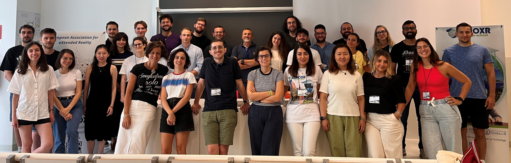

### Activities
{:.no_toc}

The workshop activities were organised into four complementary components.

1. **Lectures and expert presentations**

   Students attended lectures introducing XR technologies, interaction methods, application areas, and user-experience considerations. The presentations addressed the adoption of XR in education, healthcare, cultural heritage, and industry, illustrating current practices as well as technical and organisational challenges. These sessions provided the conceptual background needed for the group projects.

2. **Demonstrations and exploration of XR applications**

   Participants explored immersive applications and technical demonstrations presented by academic and industrial experts. The sessions allowed students to connect the concepts discussed during the lectures with working systems and to examine aspects such as navigation, interaction, accessibility, user guidance, data collection, and integration with physical devices.

3. **Challenges and project work**

   Students were divided into six multidisciplinary and international teams. Each team addressed a challenge concerning the design or development of an XR application. The project work required the teams to analyse the problem, identify the intended users, formulate the objectives of the experience, and select suitable interaction and visualisation approaches. Depending on the challenge, the teams produced application concepts, user scenarios, technical architectures, data-analysis methods, or functional prototypes.

   The six projects covered a broad range of XR applications:

   - **A. Accessible virtual cultural visits:** a VR experience enabling users to explore a cultural site through tours of different lengths. The concept considered accessibility requirements and alternative ways of navigating and receiving information about exhibits and architectural features.

      
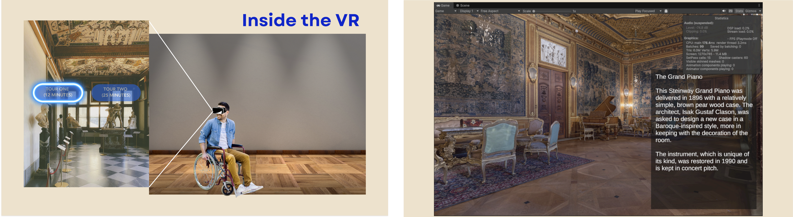

   - **B. Analysis of visitor behaviour in immersive environments:** an approach for collecting and analysing user movement and viewing data. The proposed visualisations included three-dimensional trajectories, viewing frustums, and gaze heatmaps, which could help evaluate how visitors move through and interact with a virtual environment.

      
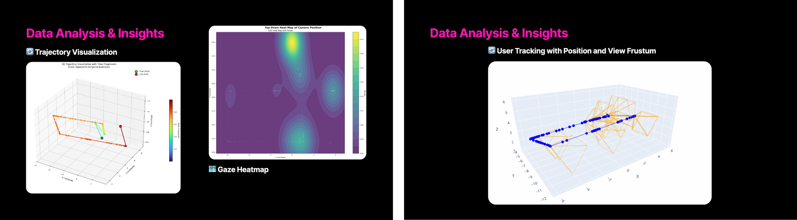

   - **C. VR training for medical emergencies:** a guided training scenario in which users learn how to respond to an emergency. The experience combined familiarisation with the virtual environment, voice-based instructions, a sequence of first-aid actions, and a final assessment intended to reinforce the procedure.

      
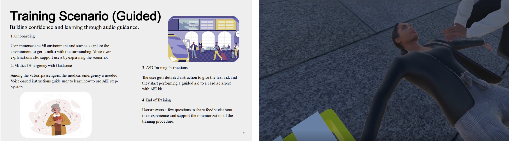

   - **D. Virtual garden maze for cognitive activities:** an immersive maze intended to support the observation or stimulation of spatial memory, executive functions, and problem-solving abilities. The concept used a naturalistic garden environment and incorporated navigation tasks and identifiable reference points.

      
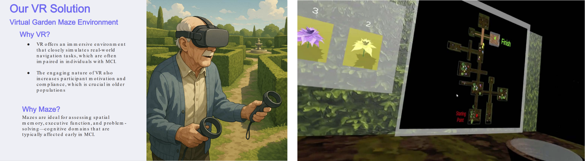

   - **E. Immersive experience for sensory awareness:** a serious-game concept set in a domestic environment. The application was designed to present a situation from different environmental and sensory perspectives, using changes to sound and surrounding stimuli to illustrate how the same space may be experienced under different conditions.

      
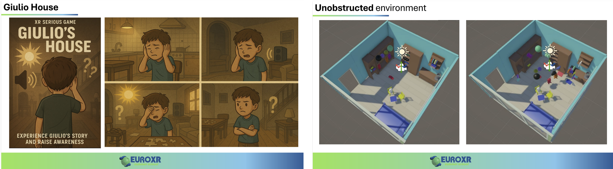

   - **F. Connection between physical and virtual objects:** a technical demonstrator exploring real-time communication between a physical object and its virtual representation through MQTT. The project also investigated the dynamic modification of a virtual mesh according to movement-related data, illustrating possible mechanisms for implementing digital-twin interactions.

      
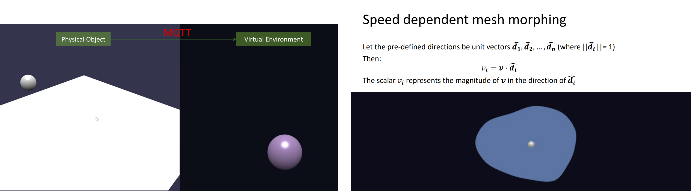

   Although the projects differed considerably in subject and technical scope, the teams followed a common user-centred process. They considered the context of use, target users, expected learning or experiential outcomes, interaction sequence, required data, and possible evaluation methods. Regular exchanges with tutors supported the refinement of the concepts and helped the teams balance user needs with the technical feasibility of their proposals.

4. **Final presentations**

   On the final day, the six teams presented their projects to the other participants and tutors. Each presentation described the challenge, target users, proposed XR solution, interaction flow, expected benefits, and main design or implementation choices. Where available, teams also presented prototypes, virtual scenes, visualisations, or technical demonstrations. The session enabled participants to compare solutions from different application domains, discuss limitations and possible improvements, and reflect on the multidisciplinary knowledge required to design effective XR experiences.

### Assessment
{:.no_toc}

The assessment examined participants’ backgrounds, expectations, learning experiences, and overall evaluation of the workshop. Feedback was collected through a questionnaire combining closed-ended items and open-ended questions. A total of 31 students participated in the assessment, including 14 XREN students and 17 other participants in the EuroXR Summer School.

Team collaboration emerged as one of the strongest results of the questionnaire. Of the 31 respondents, 20 rated collaboration as **Excellent** and nine as **Good**, while one participant selected **Fair** and one selected **Very poor**. Overall, 29 of the 31 respondents (93.5%) therefore evaluated team collaboration positively.

<pre class="mermaid">
pie showData
    title Team collaboration rating (n = 31)
    "Excellent: 20 (64.5%)" : 20
    "Good: 9 (29.0%)" : 9
    "Fair: 1 (3.2%)" : 1
    "Very poor: 1 (3.2%)" : 1
</pre>

This quantitative result is consistent with the qualitative feedback. Participants particularly valued the multidisciplinary composition of the teams, the exchange of perspectives, and the opportunity to work with students from different educational and technical backgrounds. The collaborative challenges required the teams to transform broad application problems into structured XR proposals, identify target users, define interaction sequences, and consider the technical and educational feasibility of their solutions.

The combination of lectures, demonstrations, and project work helped participants connect theoretical concepts with potential real-world applications. Teamwork also supported the development of communication, creativity, adaptability, and problem-solving skills. At the same time, the feedback identified challenges related to the intensive programme, the limited time available for project development, and differences in participants’ previous experience with XR technologies and development tools.

Overall, the completion and presentation of six distinct projects, together with the strongly positive assessment of team collaboration, indicate that the workshop successfully implemented its experiential and collaborative learning approach. The results suggest that the event strengthened participants’ understanding of XR design, application development, user-centred evaluation, and multidisciplinary collaboration [3].

## Workshop in Belgrade (25-27 May 2026)

The fourth XR Learning Workshop within the XREN project took place at University of Belgrade – Faculty of Mechanical Engineering in Belgrade, Serbia, from 25 to 27 May 2026. The workshop, titled "Extended Reality Tools to Support Learning Activities in Engineering", gathered students and project partners to investigate the potential of extended reality (XR) technologies and their application in engineering education.

The workshop combined virtual reality (VR), industrial automation, and flexible manufacturing systems through a series of practical activities. Students worked on the development of VR environments in Unity, explored an electro-pneumatic Flexible Assembly Cell and its VR-based digital twin, and became familiar with a robotic Flexible Assembly Cell and its VR-based digital shadow.

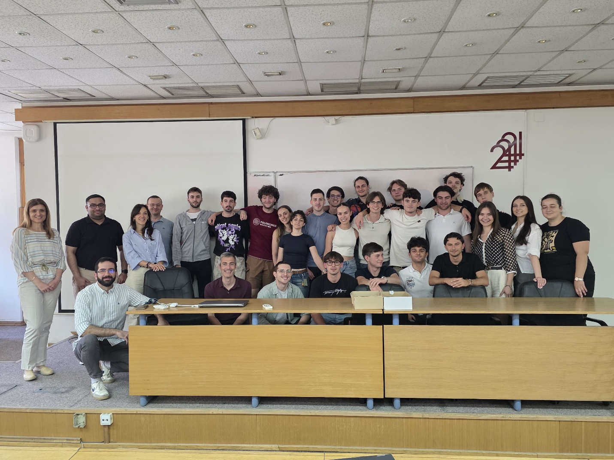

### Activities
{:.no_toc}

The activities were organized in parallel sessions, allowing students to switch between software development and practical work with real industrial systems. This approach enabled them to compare virtual representations with physical systems and to better understand the role of XR technologies in interaction with real-world systems. The program was organized into four activities.

1. **Teamwork: Developing a VR representation of an electro-pneumatic manipulator in Unity**

    One of the workshop’s main activities included team-based project work focused on developing a VR representation of an electro-pneumatic manipulator in Unity. Students imported 3D models of a manipulator into Unity and implemented basic interaction and control functionalities. They created scripts for operating the manipulator in two modes: (i) JOG mode (separate control for the movement of individual pneumatic cylinders) and (ii) automatic mode in which manipulator executed the predefined pick-and-place task through a sequence of cylinders’ movements. They also developed a human-machine interface for starting and stopping pick-and-place sequence, adjusting the speed of manipulator and switching between JOG and automatic mode. An optional extension included the implementation of a step-by-step control mode, in which the manipulator elements moved one step at a time. A brief Unity tutorial was also included on the first day of the workshop to support the students in the development of these activities.

    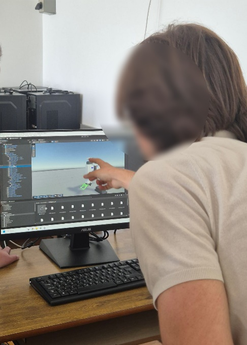

    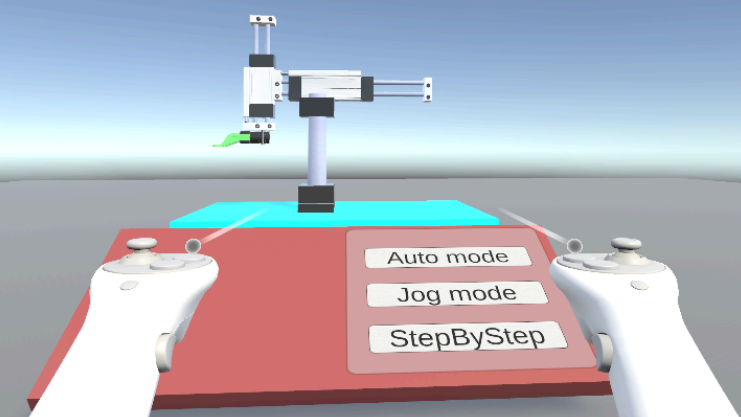

2. **Laboratory activity: Electro-pneumatic Flexible Assembly Cell and its VR-based digital twin**

    This activity introduced students to the real-world system of an [electro-pneumatic Flexible Assembly Cell](./UseCases/U08_workcell) and its VR-based digital twin. The activity included an explanation of the physical system, its hardware components, the product to be assembled, and the control system used to operate the cell. Students also used the developed VR environment to better understand the state table describing the operation of the assembly cell. Through immersion in the virtual environment, they were able to observe the sequence of operations and to correlate the virtual representation to the actual physical equipment. An important part of the activity was the demonstration of the VR-based digital twin and the two-way communication between Unity and the Programmable Controller. This enabled students to control the physical Flexible Assembly Cell from the virtual environment.

    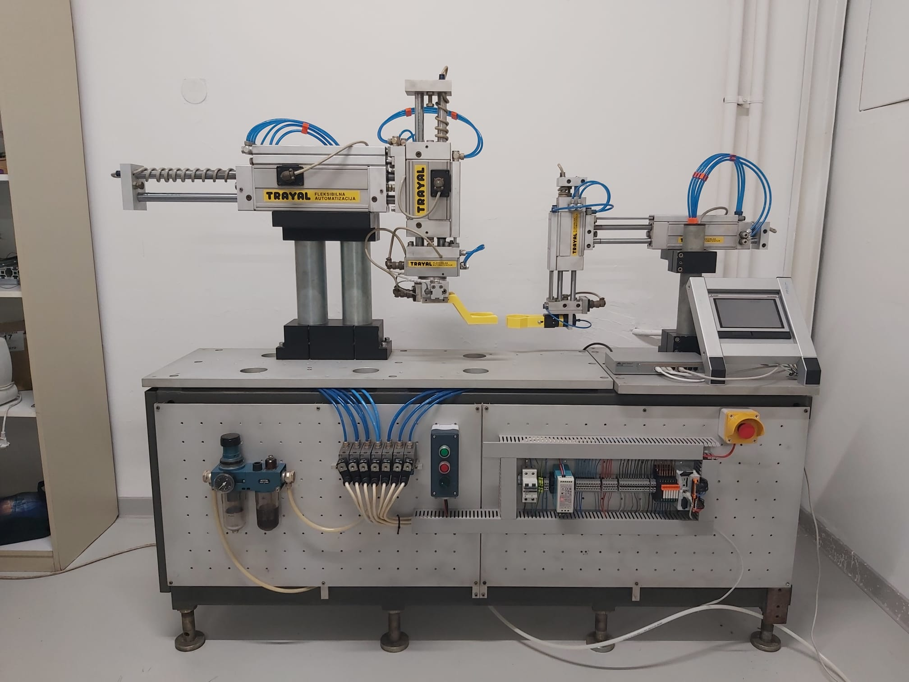 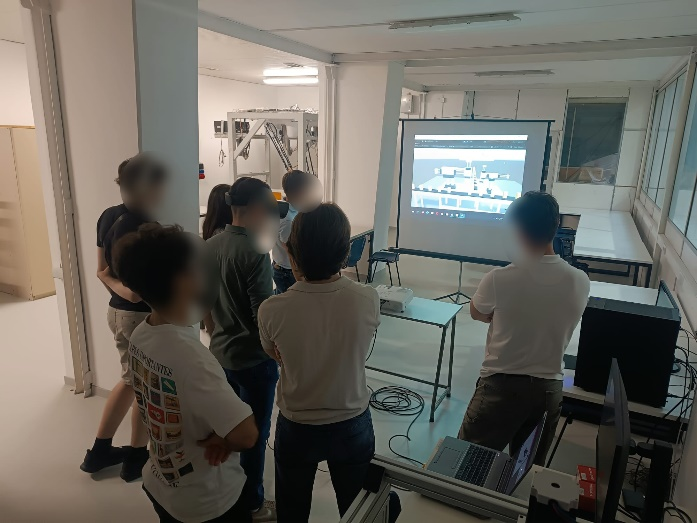

3. **Laboratory activity: Robotic Flexible Assembly Cell and its VR-based digital shadow**

    During this activity, students were first introduced to the structure of the [robotic cell](./UseCases/U09_roboticcell), its hardware components, and the control architecture used to coordinate the complete system. Particular attention was given to industrial robot control. Students became familiar with the operation of the Yaskawa SIA10F industrial robot and were introduced to basic industrial robot control through hands-on experience in programing these robots. The activity also covered communication between components of the robotic system and communication between physical assembly cell and its virtual representation. The developed digital shadow allowed students to observe the operation and assembly sequence of the robotic Flexible Assembly Cell in VR.

    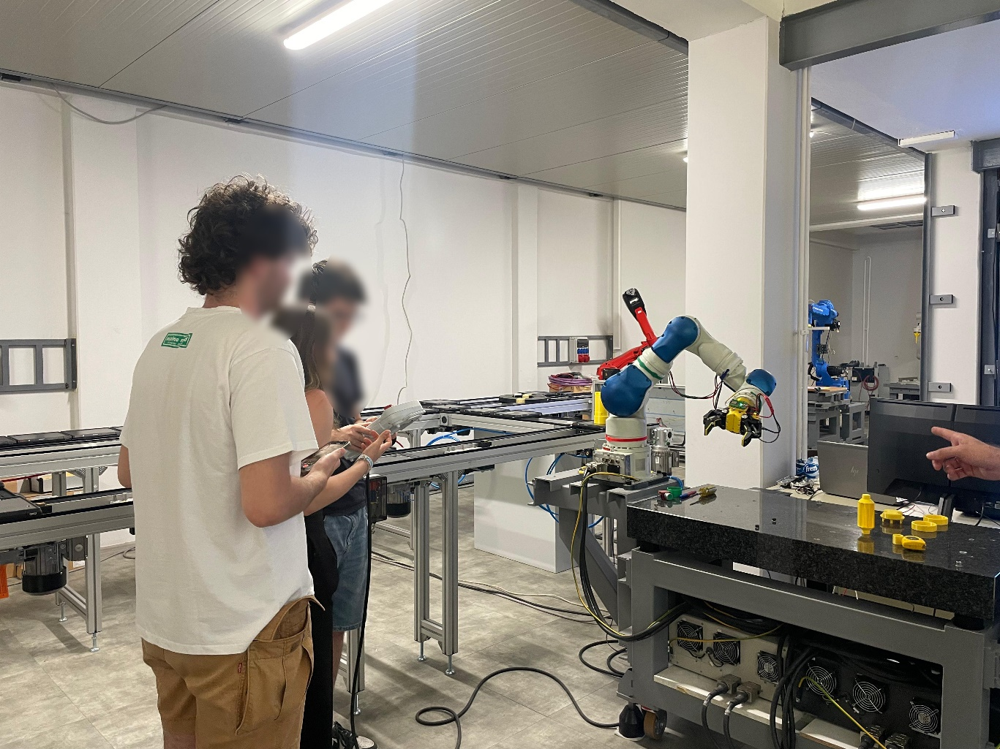

4. **Final student presentations**

    On the third day, students prepared final presentations of their work during the workshop. The presentations included both the project activities related to VR development and the laboratory activities carried out with the flexible assembly systems.

    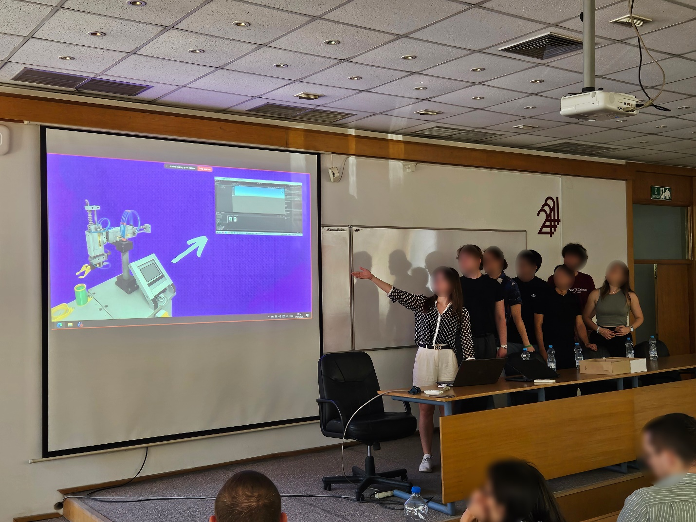

### Assessment
{:.no_toc}

The assessment of the workshop comprised two parts: (i) students’ expectations from the workshop and (ii) their feedback on the workshop experience. The questionnaire about students’ expectations included five open-ended questions in which most students anticipated positive aspects of the workshop through practical application, exposure to new engineering perspectives, improving problem-solving skills, communication, teamwork, adaptability, and confidence. Some concerns regarding intensive schedule, the technical complexity of the activities and limited familiarity with Unity and other tools were raised. A total of 22 students participated in this survey.

Workshop feedback questionnaire included one closed-ended and three open-ended questions and was answered by 20 students. Acquisition of practical and technical knowledge, exposure to the industrial applications of robotics and virtual reality, and the opportunity to apply theoretical concepts in laboratory settings were highly appreciated by students. They also valued the opportunity to work with students from different countries, exchange ideas and problem-solving approaches, develop intercultural teamwork skills, and establish new personal and professional connections. Although the feedback was overwhelmingly positive, several respondents identified areas for improvement. In particular, some students considered the Unity-based task was challenging and not fully adapted to the different levels of experience and technical backgrounds represented within the student group. Students were also asked to list three adjectives to describe their experience of the workshop. A total of 38 different adjectives were associated with the experience, and the most frequently mentioned are shown in the figure below.

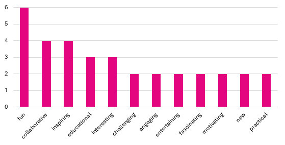

Overall, students’ expectations and feedback from the workshop were positive and well aligned.

## References
\[1\] Mondellini M, Arlati S, Urgo M, Pizzagalli S, Mahmood K, Terkaj W (2026) Comparing Traditional and eXtended Reality-Based Learning: Effects on Performance, Emotions, and Cognitive Aspects. In: De Paolis LT, Arpaia P, Sacco M (eds) Extended Reality. XR Salento 2025. Lecture Notes in Computer Science, 15742:324–336. Springer, Cham. https://doi.org/10.1007/978-3-031-97778-7_24

\[2\] Mondellini M, Arlati S, Stefanone A, Lucania E, Colombo G, Urgo M, Terkaj W (2027) Teaching product assembly with VR: advantages, shortcomings, and student perceptions. In: De Paolis, L.T., Arpaia, P., Sacco, M. (eds) Extended Reality. XR Salento 2026. Lecture Notes in Computer Science, 16837:323-336. Springer, Cham. https://doi.org/10.1007/978-3-032-33500-5_22

\[3\] Terkaj W, Arlati S, Mondellini M, Dindic A, Sacco M (2027) XR Experiential Learning in Higher Education: A Framework and Full-Immersion Workshop Experience. To appear in Springer Proceedings in Business and Economics.