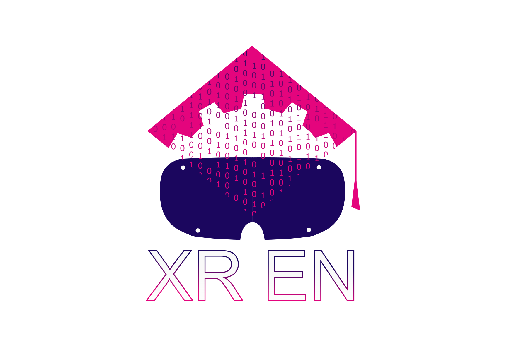

[comment]: # ()

# XREN Book

This book presents the main results of the XREN (eXtended Reality tools to support learning activities in ENgineering) [project](https://www.xr-en.eu/) (n. 2023-1-EE01-KA220-HED-000158491) funded by the European Commission’s [Erasmus+ programme](https://erasmus-plus.ec.europa.eu/projects) in the period from September 2023 to August 2026.

*The European Commission's support for the production of this publication does not constitute an endorsement of the contents, which reflect the views only of the authors, and the Commission cannot be held responsible for any use which may be made of the information contained therein.*

This introduction gives an overview of the project [consortium](#xren-consortium), [activities](#xren-activities), and [results](#xren-results).

## XREN Consortium 

The XREN project involved four partners:
* **Tallinn University of Technology** (TalTech), Department of Mechanical and Industrial Engineering ([DMIE](https://taltech.ee/en/department-mechanical-and-industrial-engineering)) 
* **Politecnico di Milano** (Polimi), Department of Mechanical Engineering ([DMEC](https://www.mecc.polimi.it/))
* **Consiglio Nazionale delle Ricerche** (CNR), Institute of Intelligent Industrial Technologies and Systems for Advanced Manufacturing ([STIIMA](https://www.stiima.cnr.it/?lang=en))
* **University of Belgrade** (UBelg), Faculty of Mechanical Engineering ([FME](http://arhiva.rect.bg.ac.rs/en/members/faculties/FME.php))

## XREN Activities

The main objective of XREN was to **strengthen the digital competences of engineering students**, with particular emphasis on extended reality (XR) technologies, while supporting the integration of XR into higher education courses in engineering.

To achieve this objective, the project developed a set of reusable learning materials organised as **XR-based learning workflows**. Each workflow specifies the learning objectives, use cases, tasks, user-experience and interaction modalities, and supporting technologies. The workflows are accompanied by relevant data, digital content, and prototype tools that support their implementation in the classroom and laboratory. These resources also facilitate collaboration among university laboratories within and beyond the XREN consortium, enabling students to participate in learning activities or access laboratory resources remotely through virtual environments.

The project aimed to develop **10 XR-based learning workflows** for industrial engineering education, supported by reference documentation and practical implementation resources. During the project, the workflows were integrated into the participating higher education institutions and tested across **three curricula and six Bachelor’s and Master’s degree courses**, delivered through both traditional and blended learning models.

The project activities were organised into four work packages:

- **WP1 – Project Management:** coordination of the project, monitoring of progress, quality assurance, and administrative and financial management.
- **WP2 – XR Workflows for Engineering Education:** development and implementation of XR-based learning workflows in real higher education settings within industrial and mechanical engineering.
- **WP3 – XR Learning Co-design Labs and Workshops:** organisation of long-term co-design laboratories in which engineering students used, tested, and contributed to the development of the XR learning workflows. WP3 also included intensive XR learning workshops that engaged students in immersive, collaborative, and practice-oriented learning experiences.
- **WP4 – Dissemination of Tools and Workflows:** communication and dissemination of the project results, including the developed tools, learning workflows, educational materials, and implementation experiences.

## XREN Results

The implementation of **WP2** resulted in the following outputs:

| Indicator | Result |
|:----------|------:|
| XR learning workflows developed | **11** |
| Industrial use cases modelled and adapted for XR workflows | **5** |
| Higher education curricula enhanced through the developed workflows | **3** |
| Engineering courses integrating the workflows by the end of the project | **6** |
| Higher education courses expected to integrate the workflows during the follow-up phase | **12** |

The implementation of **WP3** resulted in the following outputs:

| Indicator | Result |
|:----------|------:|
| Co-design activities conducted | **12** |
| Students involved in co-design activities | **64** |
| Online meetings involving students from partner universities | **12** |
| XR learning workshops conducted | **4** |
| Students participating in the workshops | **78** |

Each partner university carried out four student project activities during the three-year project period, resulting in a total of 12 co-design activities.

The implementation of **WP4** resulted in the following outputs:

| Indicator | Result |
|:----------|------:|
| Repository for publishing tools and workflows | **1** |
| Project-specific online channels | **2** |
| Articles published or accepted for publication | **6** |

The project repository contains [supporting materials](https://github.com/xrlearning/repo) (e.g. tools and use cases) and [this Book](https://xrlearning.github.io/book/) that presents:
1. [Guidelines](docs/Guidelines) for the design of XR Learning Workflows
2. [XR Learning Workflows](docs/LearningWorkflows)
3. [Tools](docs/Tools) supporting XR Learning Workflows
4. [Use Cases](docs/UseCases) supporting XR Learning Workflows
5. [Workshops](docs/Workshops) organized to provide students with opportunities to explore the use of XR in engineering education. 
6. Guidelines for the [Assessment](docs/Assessment) of the XR Learning experience

The two main project communication channels are:
- [XREN project website](https://www.xr-en.eu/)
- [XREN LinkedIn page](https://www.linkedin.com/company/extended-reality-tools-to-support-learning-activities-in-engineering-xren/posts/?feedView=all)

The following subsections list the scientific dissemination outcomes.

### Published articles

\[1\] Pizzagalli, S. L., Mahmood, K., Boychuk, R., Otto, T., and Kuts, V. (2025). **A Workflow for Extended Reality-Based Learning in Engineering Education.** *Proceedings of the Estonian Academy of Sciences*, 74(2), 103–108.  
   [https://doi.org/10.3176/proc.2025.2.03](https://doi.org/10.3176/proc.2025.2.03)

\[2\] Suvajać, Ž., Matijašević, L., Nedeljković, D., and Jakovljević, Ž. (2025). **Virtual Reality Environment for Teaching Assembly Sequence Analysis to Production Engineering Students.** In *Proceedings of the 40th International Conference on Production Engineering – Serbia, ICPES 2025*, Niš, Serbia, 18–19 September 2025. Society of Production Engineering.  
   [https://doi.org/10.46793/ICPES25.344S](https://doi.org/10.46793/ICPES25.344S)

\[3\] Mondellini, M., Arlati, S., Urgo, M., Pizzagalli, S. L., Mahmood, K., and Terkaj, W. (2026). **Comparing Traditional and eXtended Reality-Based Learning: Effects on Performance, Emotions, and Cognitive Aspects.** In *Extended Reality. XR Salento 2025*, Lecture Notes in Computer Science, pp. 324–336. Springer.  
   [https://doi.org/10.1007/978-3-031-97778-7_24](https://doi.org/10.1007/978-3-031-97778-7_24)

\[4\] Mondellini, M., Arlati, S., Stefanone, A., Lucania, E., Colombo, G., Urgo, M., and Terkaj, W. (2027). **Teaching Product Assembly with VR: Advantages, Shortcomings, and Student Perceptions.** In *Extended Reality. XR Salento 2026*, Lecture Notes in Computer Science. Springer.
    [https://doi.org/10.1007/978-3-032-33500-5_22](https://doi.org/10.1007/978-3-032-33500-5_22)

### Articles accepted for publication

\[1\] Pizzagalli, S. L., Vardak, M., Mahmood, K., and Symotiuk, I. (2026). **Simulation-Based XR Tools for Real-Time KPI Visualisation in Smart Manufacturing.** In *Proceedings of the International XR-Metaverse Conference, XRM 2026*. Springer Proceedings in Business and Economics. Springer.

\[2\] Milutinovic, V., Suvajac, Z., Matijasevic, L., and Jakovljevic, Z. (2026). **Virtual Reality Support for Learning Sequential Control.** In *Proceedings of the International XR-Metaverse Conference, XRM 2026*. Springer Proceedings in Business and Economics. Springer.

\[3\] Terkaj, W., Arlati, S., Mondellini, M., Dindic, A., and Sacco, M. (2026). **XR Learning in Higher Education: A Full-Immersion Workshop Experience.** In *Proceedings of the International XR-Metaverse Conference, XRM 2026*. Springer Proceedings in Business and Economics. Springer.

### Dissemination at international events

Project results were presented at the following international conferences and events.

\[1\] **21st EuroXR International Conference – EuroXR 2024**  
   Athens, Greece, 27–29 November 2024  
   **Contribution type:** Poster and demonstration  
   **Contribution:** *Pneumatics-Case: Enhancing Learning through Augmented Reality and Digital Twin Technology*  
   [Conference website](https://www.euroxr.org/previous-edition-conference2024)

\[2\] **Modern Materials and Manufacturing Conference – MMM 2025**  
   Tallinn, Estonia, 6–8 May 2025  
   **Contribution type:** Paper presentation  
   **Contribution:** *A Workflow for Extended Reality-Based Learning in Engineering Education*  
   [Conference website](https://taltech.ee/en/mmm2025#p6242980)

\[3\] **International Conference on eXtended Reality – XR Salento 2025**  
   Otranto, Italy, 17–20 June 2025  
   **Contribution type:** Paper presentation  
   **Contribution:** *Comparing Traditional and eXtended Reality-Based Learning: Effects on Performance, Emotions, and Cognitive Aspects*  
   [Conference website](https://www.xrsalento.it/xrsalento2025/)

\[4\] **IEEE International Conference on Metrology for eXtended Reality, Artificial Intelligence and Neural Engineering – MetroXRAINE 2025**  
   Ancona, Italy, 22–24 October 2025  
   **Contribution type:** Poster presentation  
   **Contribution:** *Extended Reality Tools to Support Learning Activities in Engineering (XREN)*  
   [Conference website](https://www.metroxraine.org/metroxraine2025/)

\[5\] **40th International Conference on Production Engineering – Serbia, ICPES 2025**  
   Niš, Serbia, 18–19 September 2025  
   **Contribution type:** Paper presentation  
   **Contribution:** *Virtual Reality Environment for Teaching Assembly Sequence Analysis to Production Engineering Students*  
   [Conference website](http://spms.fink.rs/eng/index.html)

\[6\] **International Conference on eXtended Reality – XR Salento 2026**  
   Otranto, Italy, 16–20 June 2026  
   **Contribution type:** Paper presentation  
   **Contribution:** *Teaching Product Assembly with VR: Advantages, Shortcomings, and Student Perceptions*  
   [Conference website](https://www.xrsalento.it/xrsalento2026/)

\[7\] **International XR-Metaverse Conference – XRM 2026**  
   Tallinn, Estonia, 17–19 June 2026  
   **Contribution type:** Paper presentations  
   **Contributions:**

   - *Simulation-Based XR Tools for Real-Time KPI Visualisation in Smart Manufacturing*
   - *Virtual Reality Support for Learning Sequential Control*
   - *XR Learning in Higher Education: A Full-Immersion Workshop Experience*
   [Conference website](https://www.xrm2026.com/)

---

